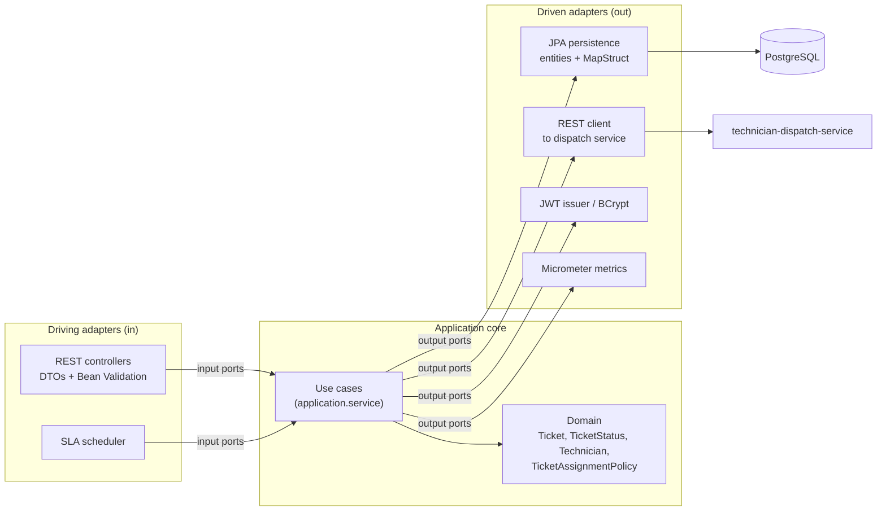
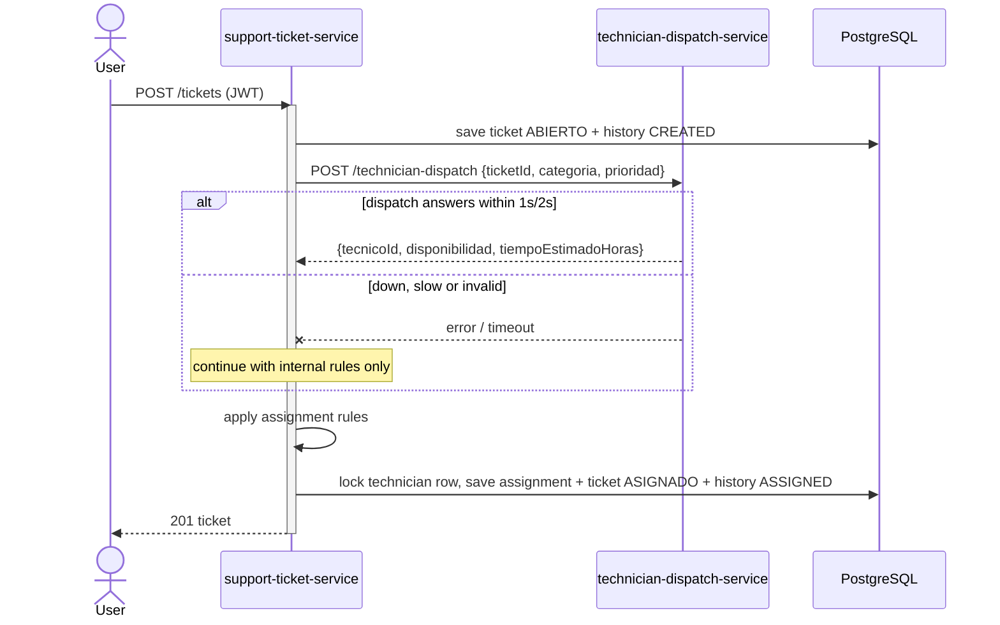
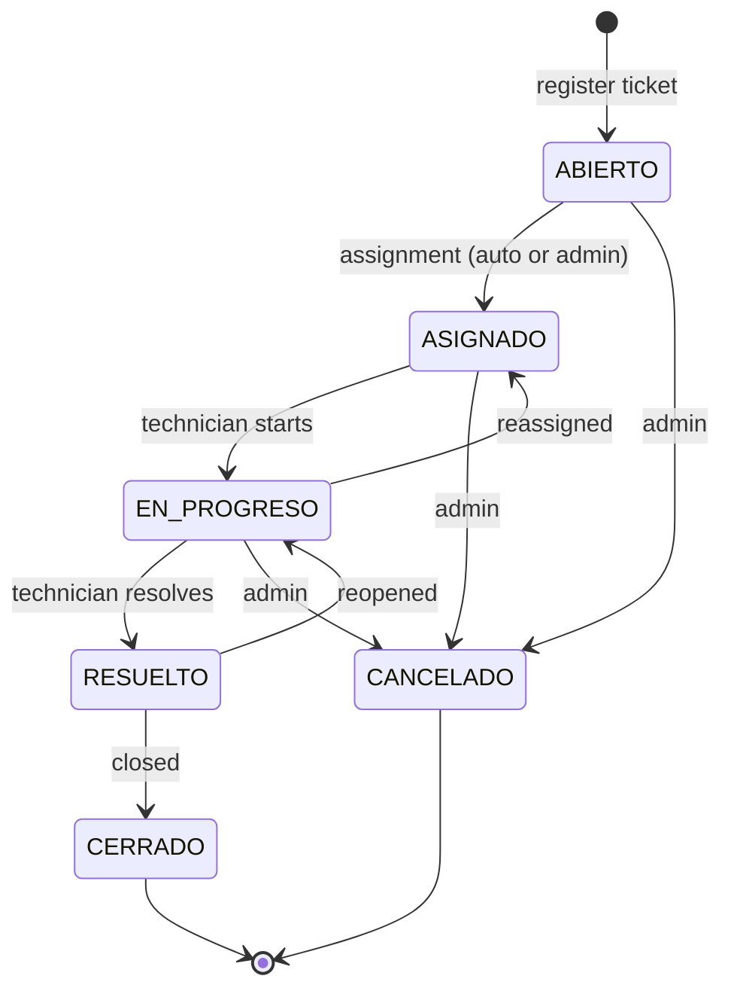

# HelpFlow - IT Support Management System

HelpFlow handles IT support requests for teams spread over several sites. It replaces e-mails and
spreadsheets with a system that registers tickets, calculates their SLA, assigns them to a technician,
keeps a full audit trail and escalates the ones that are about to miss their deadline.

It is made of **two independent microservices**:

| Service | Port | Responsibility |
|---|---|---|
| `support-ticket-service` | 8080 | Central service: users, technicians, tickets, assignment, SLA, JWT security, PostgreSQL |
| `technician-dispatch-service` | 8081 | Lightweight simulated external service: suggests a technician and an estimated time. No database, no security |

Around them: **PostgreSQL**, **Prometheus** (metrics scraping) and **Grafana** (dashboard), started with Docker Compose.

> Operational guide (start, test, troubleshoot): [`docs/RUNBOOK.md`](docs/RUNBOOK.md) -
> Real run outputs: [`docs/EVIDENCE.md`](docs/EVIDENCE.md) -
> Postman: [`docs/postman/`](docs/postman)

## Contents

1. [Quick start](#quick-start)
2. [Architecture](#architecture)
3. [Ticket flow, assignment rules and SLA](#ticket-flow-assignment-rules-and-sla)
4. [Roles and access control](#roles-and-access-control)
5. [Endpoints](#endpoints)
6. [Error format and i18n](#error-format-and-i18n)
7. [Persistence](#persistence)
8. [Observability](#observability)
9. [Testing](#testing)
10. [Configuration](#configuration)
11. [Project layout and design decisions](#project-layout-and-design-decisions)

## Quick start

Requirements: Docker with Compose v2 (to run), JDK 21+ and Docker (to build and test locally).

```bash
./scripts/setup-env.sh              # creates .env with random secrets (git-ignored)
docker compose up -d --build        # PostgreSQL, both services, Prometheus, Grafana
./scripts/smoke-test.sh             # end-to-end check against the running stack
```

| What | URL |
|---|---|
| Swagger UI (support-ticket-service) | http://localhost:8080/swagger-ui.html |
| Swagger UI (technician-dispatch-service) | http://localhost:8081/swagger-ui.html |
| Prometheus | http://localhost:9090 |
| Grafana (user `admin`, password in `.env`) | http://localhost:3000 -> folder *HelpFlow* |

`./scripts/setup-env.sh` also defines the first-run accounts: the admin `admin@helpflow.example` and one
login per seeded technician (`tec-001@helpflow.example` ... `tec-015@helpflow.example`); their passwords are
in `.env` (`BOOTSTRAP_ADMIN_PASSWORD`, `BOOTSTRAP_TECHNICIAN_PASSWORD`). Regular users self-register with
`POST /auth/register`.

Stop with `docker compose down` (data is kept in volumes) or `docker compose down -v` (wipes everything).

### Running without Docker for the services

```bash
docker compose up -d db                          # PostgreSQL on localhost:5433
set -a; source .env; set +a
./mvnw -pl technician-dispatch-service spring-boot:run     # terminal 1 (port 8081)
./mvnw -pl support-ticket-service spring-boot:run          # terminal 2 (port 8080)
```

## Architecture

### Hexagonal architecture (support-ticket-service)



```
com.helpflow.supportticket
├── domain
│   ├── model        Ticket, TicketStatus, Technician, User, SlaPolicy, ... (no framework imports)
│   ├── service      TicketAssignmentPolicy (assignment rules)
│   └── exception    DomainException hierarchy (code + args, no messages)
├── application
│   ├── port.in      use case interfaces (RegisterUser, CreateTicket, ChangeTicketStatus, ...)
│   ├── port.out     UserRepositoryPort, TicketRepositoryPort, TechnicianDispatchPort, TicketMetricsPort, ...
│   └── service      use case implementations (@Transactional)
└── infrastructure
    ├── adapter.in.web         controllers, DTOs, MapStruct mappers, @RestControllerAdvice, trace id filter
    ├── adapter.in.scheduler   SlaEscalationJob
    ├── adapter.out.persistence  JPA entities, Spring Data repositories, adapters, MapStruct mappers
    ├── adapter.out.dispatch   RestClient adapter (timeouts)
    ├── adapter.out.security   JWT issuer, BCrypt hasher
    ├── adapter.out.metrics    Micrometer adapter
    └── config                 Spring Security, OpenAPI, locale, bootstrap accounts
```

Rules that keep it hexagonal: the domain imports nothing from Spring, JPA or Jackson; use cases depend only
on ports; entities are separate from domain objects and translated by MapStruct; controllers only validate and
delegate; the dependency arrows point inwards. `technician-dispatch-service` follows the same layering in
miniature (domain selector, one use case, one controller) and uses no JPA or security, as required.

### How the microservices relate



The whole registration (ticket, assignment, history) is **one transaction**. The `X-Trace-Id` header is
forwarded to the dispatch service so one request can be followed in both services' logs.

## Ticket flow, assignment rules and SLA

### Lifecycle



Every transition requires `observations`, is validated by the domain state machine (`409` when not allowed) and
is recorded in `ticket_history`. `ASIGNADO` is reached only by assigning a technician.

### Automatic assignment

1. The SLA deadline is calculated: `slaDueAt = createdAt + resolutionHours(priority)` (calendar hours).
2. `technician-dispatch-service` returns a suggested technician and an estimate (0-2 h `ALTA`, 3-8 h `MEDIA`, >8 h `BAJA`).
3. A technician is **eligible** if they are `ACTIVO`, their specialty matches the category (or they are a generalist `OTRO`;
   category `OTRO` accepts anyone) and they have capacity: `maxActiveTickets` tickets in `ASIGNADO`/`EN_PROGRESO`
   (`CRITICA` tickets may use one extra slot).
4. The dispatch suggestion wins when the technician is eligible **and** the estimate fits in the time left before the SLA deadline.
   Otherwise the eligible technicians are ranked: same site first, then lowest workload, then code.
5. Capacity is re-checked under a pessimistic row lock, so concurrent registrations cannot overfill a technician.
6. With nobody eligible the ticket stays `ABIERTO` (history `ASSIGNMENT_PENDING`) until an admin assigns it.
7. If the dispatch service is down or slow, step 4 simply uses the rules (the ticket is still registered and assigned).

The assignment record keeps the `source` (`DISPATCH`, `RULES`, `MANUAL`), the estimate and whether it fits the SLA.

### SLA and escalation

| Priority | Resolution window (default) | Escalates at |
|---|---|---|
| CRITICA | 4 h | 80 % of the window |
| ALTA | 8 h | 80 % |
| MEDIA | 24 h | 80 % |
| BAJA | 72 h | 80 % |

Admins change them with `PUT /sla-policies/{priority}` (applies to new tickets). A scheduler (`app.sla.review-interval`,
default every minute) and `POST /tickets/escalations` run the same review:

* **Escalation:** an unresolved ticket that consumed the threshold gets its priority raised one level
  (`CRITICA` stays), `escalated = true`, history `ESCALATED`, metric `helpflow_tickets_escalated_total`. It happens once per ticket.
* **Breach:** an unresolved ticket past `slaDueAt` is flagged `slaBreached = true`, history `SLA_BREACHED`,
  metric `helpflow_tickets_sla_breached_total`. A ticket resolved after its deadline is flagged too.
* `GET /tickets?overdue=true` lists unresolved tickets whose deadline has passed.

## Roles and access control

Stateless **JWT** (HS256) obtained from `POST /auth/login`; passwords are hashed with BCrypt (`PasswordEncoder`).
Self-registration always creates `ROLE_USUARIO`; admins create technicians (`ROLE_TECNICO`).

| Capability | USUARIO | TECNICO | ADMIN |
|---|:-:|:-:|:-:|
| Create tickets | yes | no | yes |
| See tickets | only its own | only assigned to it | all |
| Change ticket status | no | assigned tickets, no cancel | all |
| Assign / reassign, cancel | no | no | yes |
| SLA policies | read | read | read + configure |
| Users, technicians management | own profile | own profile | all |
| `/actuator/metrics` and health details | no | no | yes |

Authentication (valid token -> 401 otherwise) is enforced by the security filter chain; the role matrix is in
`SecurityConfig`; **ownership** (who may see which ticket) is enforced inside the use cases (`403`).
`/actuator/health`, `/actuator/info`, `/actuator/prometheus`, Swagger and `/auth/*` are public; nothing else of Actuator is exposed.

## Endpoints

Full request/response examples, rules and test cases are in **Swagger UI** (`/swagger-ui.html`); the OpenAPI
document is at `/v3/api-docs`. Summary:

**technician-dispatch-service (8081)**

| Method | Path | Description |
|---|---|---|
| POST | `/technician-dispatch` | Deterministic technician suggestion `{ticketId, categoria, prioridad}` |

**support-ticket-service (8080)**

| Method | Path | Who | Description |
|---|---|---|---|
| POST | `/auth/register` | public | Create a `ROLE_USUARIO` account |
| POST | `/auth/login` | public | Obtain a JWT |
| GET | `/users/me` | any | Current profile |
| GET | `/users` | ADMIN | Paginated list (filters: status, role, site) |
| GET / PUT | `/users/{id}` | self / ADMIN | Read / edit basic information |
| PATCH | `/users/{id}/status` | ADMIN | Activate / deactivate |
| POST / GET | `/technicians` | ADMIN | Create (account + profile) / list |
| GET / PUT | `/technicians/{id}` | ADMIN | Read / edit profile (specialty, site, capacity, status) |
| POST | `/tickets` | USUARIO, ADMIN | Register a ticket (SLA + automatic assignment) |
| GET | `/tickets` | any (scoped) | Paginated list: status, priority, category, overdue, sort |
| GET | `/tickets/{id}` | owner / assigned / ADMIN | Ticket detail |
| GET | `/tickets/{id}/history` | owner / assigned / ADMIN | Audit trail |
| GET | `/tickets/{id}/assignments` | owner / assigned / ADMIN | Assignment records |
| PATCH | `/tickets/{id}/status` | TECNICO, ADMIN | State transition with observations |
| PUT | `/tickets/{id}/assignment` | ADMIN | Assign / reassign |
| POST | `/tickets/escalations` | ADMIN | Run the SLA review now |
| GET / PUT | `/sla-policies`, `/sla-policies/{priority}` | any / ADMIN | Read / configure SLA |
| GET | `/actuator/health`, `/info`, `/prometheus` | public | Operations |
| GET | `/actuator/metrics` | ADMIN | Micrometer metrics |

Enumerations follow the specification: categories `HARDWARE, SOFTWARE, RED, ACCESOS, OTRO`; priorities
`BAJA, MEDIA, ALTA, CRITICA` (`CRÍTICA`, any case, also accepted); statuses `ABIERTO, ASIGNADO, EN_PROGRESO,
RESUELTO, CERRADO, CANCELADO`; roles `ROLE_USUARIO, ROLE_TECNICO, ROLE_ADMIN`. Class and field names are English; the
API values listed above and the dispatch contract (`categoria`, `prioridad`, `tecnicoId`, ...) keep the specification's Spanish.

## Error format and i18n

All errors use **RFC 7807** `application/problem+json`:

```json
{
  "type": "urn:helpflow:problem:ticket-not-found",
  "title": "Ticket not found",
  "status": 404,
  "detail": "Ticket 999 does not exist.",
  "instance": "/tickets/999",
  "timestamp": "2026-10-27T19:25:42.396996542Z",
  "traceId": "da01b6d37b7145d18f0d5ea642e2cc8e"
}
```

Validation errors add `errors: [{field, message}]`. `traceId` is also returned in `X-Trace-Id` and appears in every
structured log line. A single `@RestControllerAdvice` maps domain exceptions (404 not found, 409 duplicate / invalid
transition / concurrent modification, 422 business rule, 403 forbidden, 401 credentials), Bean Validation, JPA integrity
and unexpected errors; 401/403 raised by the security filters use the same format.

**Internationalization:** error titles/details and validation messages are available in **English** (default) and
**Spanish**. Send `Accept-Language: es` to get Spanish; unsupported languages fall back to English. Messages live in
`messages.properties` / `messages_es.properties`; the domain only raises codes, never texts.

## Persistence

PostgreSQL 16 with Flyway migrations (`db/migration`); Hibernate runs with `ddl-auto: validate`.

| Migration | Content |
|---|---|
| `V1__schema.sql` | `users`, `technicians`, `tickets`, constraints, indexes, technician code sequence |
| `V2__asignaciones_historial_sla.sql` | `ticket_assignments` (one active per ticket), `ticket_history`, `sla_policies` + defaults |
| `V3__datos_iniciales.sql` | 15 seeded technicians `TEC-001..TEC-015` (3 sites x 5 specialties) |

JPA design: User 1-N Tickets, Ticket 1-N History, Ticket N-1 Technician (all `LAZY`). N+1 is avoided with
`@EntityGraph` on the paginated ticket queries (requester + technician in one select), a single grouped query for
technician workload, and `default_batch_fetch_size`. Tickets carry an `@Version` (optimistic locking, `409` on
conflict) and technician capacity is protected with a `PESSIMISTIC_WRITE` row lock. Assignment and escalation run
inside `@Transactional` use cases.

## Observability

* **Actuator:** `/actuator/health` (+ `liveness`/`readiness`), `/actuator/info`, `/actuator/metrics` (admin), `/actuator/prometheus`.
  Every metric carries the tag `application`.
* **Business metrics (Micrometer):**
  `helpflow_tickets_registered_total{category,priority}`, `helpflow_tickets_first_response_seconds_{count,sum,max}`,
  `helpflow_tickets_resolution_seconds_{count,sum,max}`, `helpflow_tickets_overdue` (gauge), `helpflow_tickets_sla_breached_total`,
  `helpflow_tickets_escalated_total`, `helpflow_tickets_assigned_total{source}`, `helpflow_auth_failures_total{reason}`,
  `helpflow_access_denied_total`. Mean first response = `sum / count`.
* **Prometheus** scrapes both services every 15 s (`monitoring/prometheus/prometheus.yml`); history lives in the `prometheus-data` volume (15 days).
* **Grafana** provisions the Prometheus datasource and the dashboard *HelpFlow - Services Overview*
  (availability, SLA, HTTP rate/errors/latency p95, business metrics, JVM, CPU, DB pool). Data in the `grafana-data` volume.
* **Structured logging:** JSON (Elastic Common Schema) on stdout with `traceId`; set `LOG_FORMAT=` to an empty value
  for plain text when running locally.


## Testing

```bash
./mvnw clean verify          # unit tests + Testcontainers integration tests (Docker required)
./mvnw test                  # unit tests only
./scripts/smoke-test.sh      # end-to-end against docker compose
./scripts/demo-sla.sh        # escalation / breach walkthrough with backdated tickets
```

* **Unit (JUnit 5 + Mockito):** domain rules (state machine, SLA, capacity, assignment policy), every use case with
  all ports mocked (including `TechnicianDispatchPort`), the REST dispatch adapter against a mock server.
* **Integration (Spring Boot Test + MockMvc + Testcontainers PostgreSQL):** registration/login, full lifecycle,
  role and ownership matrix, assignment rules, concurrent registrations, SLA escalation with a controllable clock,
  pagination/filters, N+1 guarantees (Hibernate statistics), Actuator access rules, i18n and OpenAPI completeness.
* **Postman:** `docs/postman/` has the collection (54 requests with assertions) and a local environment.

## Configuration

Secrets come from the environment (`.env`, never committed). Main variables:

| Variable | Used by | Meaning |
|---|---|---|
| `DB_URL`, `DB_USER`, `DB_PASSWORD` | ticket service | PostgreSQL connection (no default password) |
| `JWT_SECRET` | ticket service | HS256 key, >= 32 characters; the service refuses to start without it |
| `JWT_EXPIRATION` | ticket service | Token lifetime, ISO-8601 (default `PT1H`) |
| `DISPATCH_BASE_URL`, `DISPATCH_CONNECT_TIMEOUT`, `DISPATCH_READ_TIMEOUT` | ticket service | Dispatch client |
| `SLA_REVIEW_INTERVAL` | ticket service | Scheduler period (default `PT1M`) |
| `BOOTSTRAP_ADMIN_EMAIL/PASSWORD`, `BOOTSTRAP_TECHNICIAN_PASSWORD` | ticket service | Optional first-run accounts |
| `DISPATCH_TECHNICIAN_POOL_SIZE` | dispatch service | Codes `TEC-001..TEC-n` (default 15, matches the seed) |
| `LOG_FORMAT` | both | `ecs` (default) or empty for plain text |

## Project layout and design decisions

```
.
├── pom.xml                          parent (Spring Boot 3.5, Java 21)
├── support-ticket-service/          hexagonal service + Dockerfile + Flyway + tests
├── technician-dispatch-service/     lightweight service + Dockerfile + tests
├── docker-compose.yml               db, both services, prometheus, grafana
├── monitoring/                      prometheus.yml, Grafana provisioning and dashboard
├── scripts/                         setup-env, smoke-test, demo-sla
└── docs/                            RUNBOOK, EVIDENCE, postman, images
```

| Decision | Reason / alternative |
|---|---|
| Two microservices only | The specification asks for exactly these two; no gateway, config server or broker was added |
| Domain objects are immutable records | State changes are explicit; the persistence adapter decides when to save. Alternative: rich mutable entities mixed with JPA |
| Separate JPA entities + MapStruct | Keeps the domain free of JPA; costs one mapper per aggregate |
| `@Transactional` on use cases | The specification requires assignment + history in one transaction; it is the only Spring annotation in the application layer |
| Dispatch call inside the transaction | Simpler and atomic; bounded by 1 s / 2 s timeouts and with graceful fallback. Alternative: call before opening the transaction |
| Fallback to internal rules when dispatch fails | Registration must not depend on the availability of a simulated external service |
| Pessimistic lock on technician rows | Guarantees capacity under concurrency; optimistic retries would be the alternative |
| JWT with Spring's resource server (Nimbus) | No extra JWT library; HS256 with a secret from the environment |
| Prometheus counter `helpflow.tickets.registered` | `created` is a reserved Prometheus suffix and Micrometer would rename the series |
| No Angular frontend | The specification asks for Swagger and a test collection; Swagger UI is the client |

## Known limitations

* The SLA scheduler is designed for a single instance (several replicas would need a distributed lock).
* Tokens are not revocable: deactivating a user blocks login and ticket creation immediately, but an already issued
  token stays valid until it expires (default 1 h).
* SLA windows use calendar hours, not business hours.
* Actuator `prometheus` is public inside the Docker network by design (Prometheus scrapes it without credentials); do not
  publish port 8080 to the internet without a reverse proxy that restricts `/actuator`.
