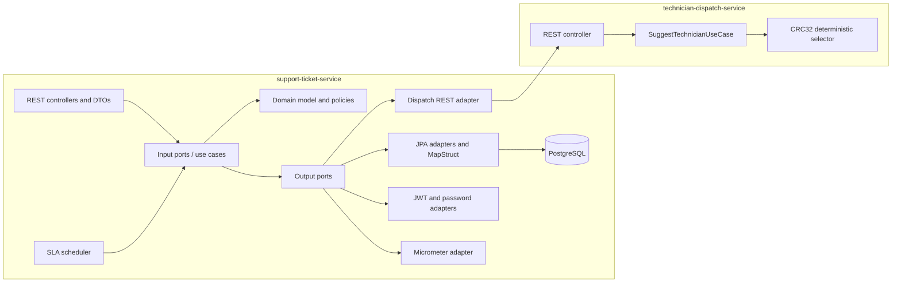
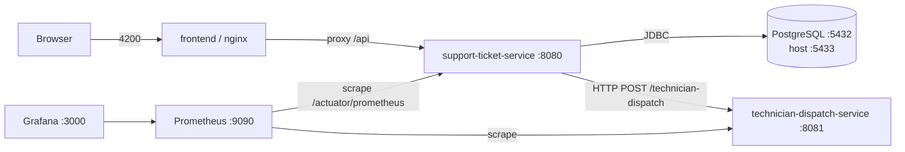
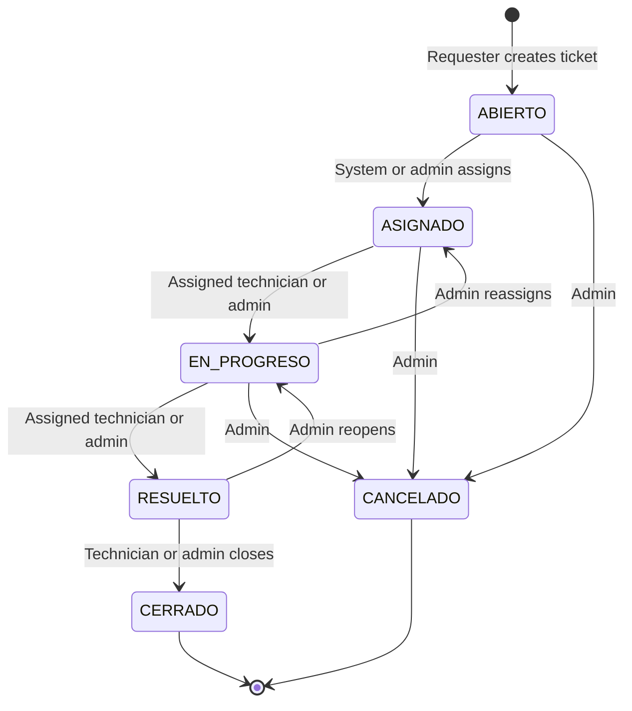
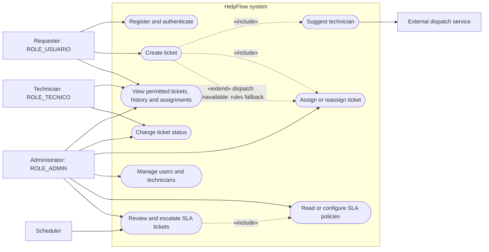
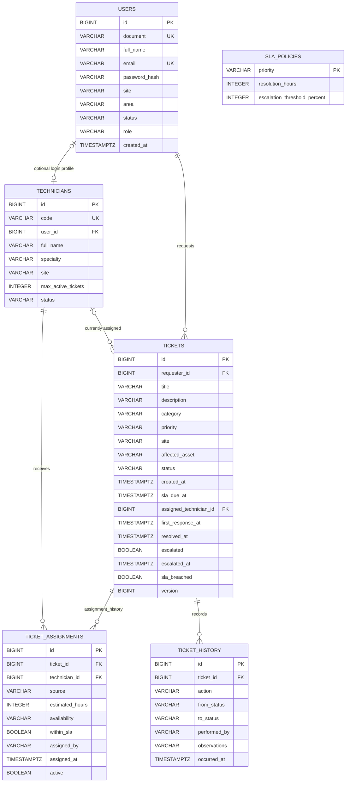
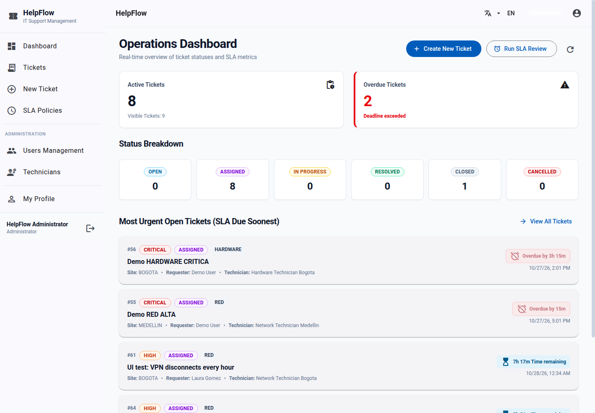
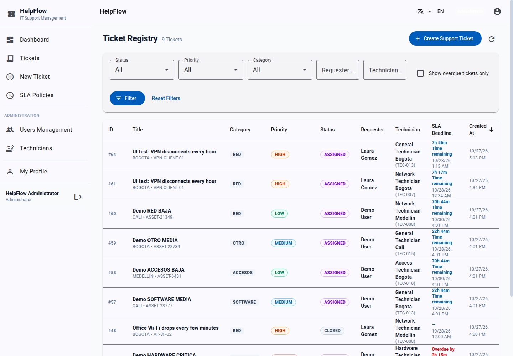
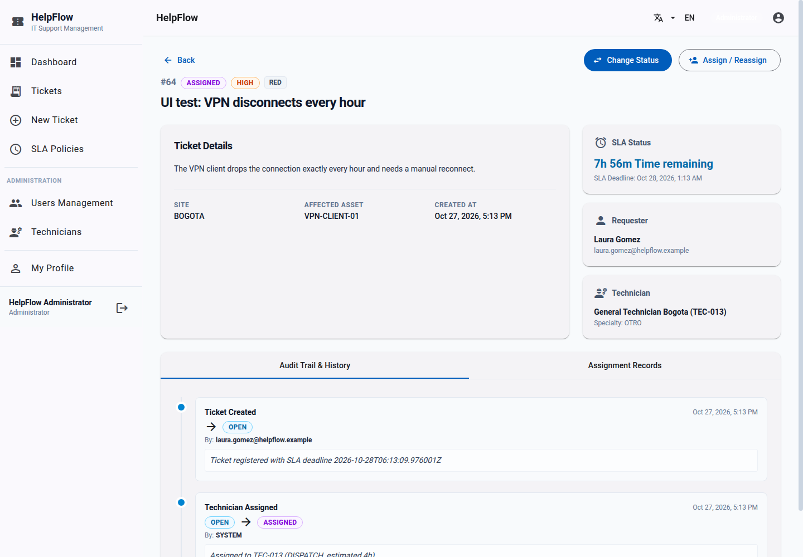
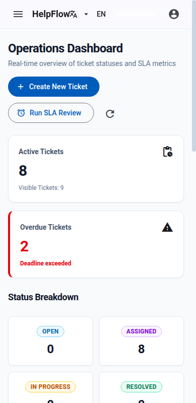

# HelpFlow — IT Support Management

   

HelpFlow is a ticketing platform for distributed IT support teams. It combines a secured ticket service, a deterministic technician dispatch simulator, a web frontend, PostgreSQL persistence, and monitoring.

## Contents

- [Objective and scope](#objective-and-scope)
- [Technology stack](#technology-stack)
- [Architecture](#architecture)
- [Project structure](#project-structure)
- [Domain and database](#domain-and-database)
- [Ticket flow, assignment, and SLA](#ticket-flow-assignment-and-sla)
- [Roles and access control](#roles-and-access-control)
- [Endpoints](#endpoints)
- [Errors and localization](#errors-and-localization)
- [Seed and example data](#seed-and-example-data)
- [Running HelpFlow](#running-helpflow)
- [Tests and API collection](#tests-and-api-collection)
- [Observability](#observability)
- [Diagrams](#diagrams)
- [Screenshots](#screenshots)
- [Design decisions](#design-decisions)
- [Known limitations and future work](#known-limitations-and-future-work)
- [Author](#author)

## Objective and scope

HelpFlow replaces scattered email and spreadsheet support requests with traceable tickets, role-based access, automatic technician assignment, SLA deadlines and escalation, and an audit history. Requesters create and track their requests; technicians work assigned requests; administrators manage accounts, technicians, assignments and SLA policy.

The backend consists of two Maven services. `support-ticket-service` owns the domain and database. `technician-dispatch-service` is a stateless simulated external dependency. The Angular web client is an additional user interface.

## Technology stack

| Area | Verified technology |
|---|---|
| Runtime | Java 21; Spring Boot 4.1.2 |
| Ticket service | Spring MVC, Spring Security resource server, Spring Data JPA, Hibernate, Bean Validation, Flyway, MapStruct 1.6.3, springdoc OpenAPI 3.2.0 |
| Dispatch service | Spring MVC, Bean Validation, Actuator; no JPA or security |
| Database | PostgreSQL 16; Flyway-managed schema |
| Web client | Angular 22, Angular Material, Tailwind CSS 4, nginx |
| Metrics | Actuator, Micrometer Prometheus registry, Prometheus 3.5.0, Grafana 11.6.0 |
| Testing | JUnit, Mockito, Spring Boot Test, Testcontainers PostgreSQL |
| Packaging | Maven multi-module, Docker Compose |

Spring-managed versions beyond the explicit versions above come from the Spring Boot parent in the root `pom.xml`.

## Architecture

### Hexagonal services

The ticket service separates `domain`, `application` and `infrastructure`. Controllers and the SLA scheduler call input ports/use cases. Use cases apply domain rules and use output ports for persistence, technician dispatch, token/password operations and metrics. Infrastructure adapters implement those ports. JPA entities are separate from domain objects and are mapped with MapStruct.

The dispatch service has an HTTP input adapter, `SuggestTechnicianUseCase`, and a deterministic domain selector. It has no database. See [hexagonal architecture](docs/diagramas/hexagonal-architecture.md) and [use cases by actor](docs/diagramas/use-cases.md).

### Microservice contract and communication

The ticket service calls dispatch synchronously through its REST adapter, with 1-second connect and 2-second read timeouts. Docker uses `technician-dispatch-service:8081`; local execution uses `localhost:8081`. The trace ID is forwarded as `X-Trace-Id`.

The required route is retained as **`POST /technician-dispatch`**:

```json
{
  "ticketId": 125,
  "categoria": "RED",
  "prioridad": "ALTA"
}
```

Response shape (the exact suggestion depends on the deterministic CRC32 seed):

```json
{
  "ticketId": 125,
  "tecnicoId": "TEC-008",
  "disponibilidad": "MEDIA",
  "tiempoEstimadoHoras": 3
}
```

Fields and enum values retain the Spanish contract spelling. Repeating the same `ticketId`, `categoria`, and `prioridad` yields the same suggestion. The dispatch service is configured with the 15 seeded technicians and their specialties (`dispatch.technicians`) and only suggests technicians able to handle the category (own specialty, generalist `OTRO`, or anybody for `OTRO` tickets), so a suggestion is compatible by construction. The ticket service still validates it against active status, capacity, site and SLA rules. If dispatch is unavailable, it applies its rules without a suggestion.

See [microservice architecture](docs/diagramas/microservices-architecture.md) and [ticket creation sequence](docs/diagramas/ticket-creation-sequence.md).

## Project structure

```text
.
├── support-ticket-service/
│   └── src/main/java/com/helpflow/supportticket/
│       ├── domain/          # framework-independent models, policies, exceptions
│       ├── application/     # input/output ports, use cases and application services
│       └── infrastructure/  # REST, scheduler, JPA, dispatch, security, metrics, config
├── technician-dispatch-service/
│   └── src/main/java/com/helpflow/dispatch/
│       ├── domain/          # deterministic selector, values and domain exceptions
│       ├── application/     # suggestion use case and port
│       └── infrastructure/  # REST adapter, configuration and error handling
├── frontend/               # Angular SPA and nginx configuration
├── docs/                   # guides, evidence, Postman, diagrams and screenshots
├── monitoring/             # Prometheus scrape config and Grafana provisioning
├── scripts/                # local environment setup helpers
├── docker-compose.yml
└── pom.xml                  # Maven parent and modules
```

Within `support-ticket-service`, `application/port/in` declares use cases and `application/port/out` declares dependencies. `infrastructure/adapter/in` contains web and scheduler adapters; `infrastructure/adapter/out` contains persistence, dispatch, security and metrics adapters.

## Domain and database

Flyway migrations `V1__schema.sql`, `V2__asignaciones_historial_sla.sql` and `V3__datos_iniciales.sql` define the schema. Hibernate validates rather than creates it (`ddl-auto: validate`). The [ER diagram](docs/diagramas/der.md) lists persisted columns and relationships.

- `users` stores unique document and email, account status and one role.
- `technicians` stores the support profile; `user_id` is optional and unique when present.
- `tickets` links a requester to a ticket and optionally to the currently assigned technician. It stores SLA timestamps, status, escalation flags and an optimistic version.
- `ticket_assignments` keeps assignment history; at most one active assignment per ticket.
- `ticket_history` stores actions, status changes, actors, observations and timestamps.
- `sla_policies` stores resolution hours and escalation threshold per priority.

Dispatch has no tables.

## Ticket flow, assignment, and SLA

The [lifecycle diagram](docs/diagramas/ticket-lifecycle.md) shows valid states. State values are `ABIERTO` (open), `ASIGNADO` (assigned), `EN_PROGRESO` (in progress), `RESUELTO` (resolved), `CERRADO` (closed), and `CANCELADO` (cancelled).

A new ticket starts `ABIERTO`. Its deadline is `createdAt + resolutionHours` in calendar hours, then dispatch is queried and the internal assignment policy is applied. With an eligible technician, the ticket becomes `ASIGNADO`; with none, it remains open and the history records `ASSIGNMENT_PENDING`. Ticket, initial assignment and history are persisted transactionally.

A technician must be active, match the ticket category (specialty `OTRO` is generalist; category `OTRO` accepts any specialty), and be below capacity. A `CRITICA` ticket can use one extra capacity slot. An eligible dispatch suggestion is preferred when its estimate fits the remaining SLA window (estimates are 0-12 h, so with `ALTA` and `CRITICA` windows many are discarded as too long; with `MEDIA` almost all are accepted). Otherwise, eligible staff are ranked by same site, then lower active workload, then technician code. Capacity is rechecked under a pessimistic row lock.

Default SLA policies are `CRITICA`: 4 hours, `ALTA`: 8, `MEDIA`: 24, `BAJA`: 72; escalation threshold defaults to 80%. Administrators can change policies; changes apply to newly created tickets. The scheduler reviews every minute (after a 30-second initial delay) and `POST /tickets/escalations` triggers a review on demand. A ticket is escalated once by increasing priority one level (up to `CRITICA`), setting its escalation fields and adding history. A deadline breach sets `slaBreached`; it does not extend the deadline.

## Roles and access control

JWT authentication is stateless. Public registration creates only `ROLE_USUARIO`. Authorization combines route roles with ownership/assignment checks in application services.

| Endpoint group | `ROLE_USUARIO` | `ROLE_TECNICO` | `ROLE_ADMIN` |
|---|---:|---:|---:|
| `/auth/register`, `/auth/login` | Public | Public | Public |
| `GET /users/me`, own `GET/PUT /users/{id}` | Yes | Own profile | Yes |
| `GET /users`, `PATCH /users/{id}/status` | No | No | Yes |
| `/technicians/**` | No | No | Yes |
| `POST /tickets` | Yes | No | Yes |
| `GET /tickets` and ticket detail/history/assignments | Own tickets | Assigned tickets | All tickets |
| `PATCH /tickets/{id}/status` | No | Assigned tickets, no cancellation | Yes |
| `PUT /tickets/{id}/assignment`, `POST /tickets/escalations` | No | No | Yes |
| `GET /sla-policies` | Authenticated | Authenticated | Authenticated |
| `PUT /sla-policies/{priority}` | No | No | Yes |
| `/actuator/health`, `/actuator/info`, `/actuator/prometheus` | Public | Public | Public |
| `/actuator/metrics` | No | No | Yes |

OpenAPI/Swagger endpoints are public. User self-service restrictions also apply to user profile endpoints.

## Endpoints

All ticket-service routes are under `http://localhost:8080`. Unless marked public, they require `Authorization: Bearer <JWT>`.

### Authentication and users

| Method | Route | Role | Description |
|---|---|---|---|
| POST | `/auth/register` | Public | Register requester account (`ROLE_USUARIO`) |
| POST | `/auth/login` | Public | Authenticate and issue JWT |
| GET | `/users/me` | Any authenticated | Read own profile |
| GET | `/users` | ADMIN | Paginated user search |
| GET | `/users/{id}` | ADMIN or self | Read profile |
| PUT | `/users/{id}` | ADMIN or self | Update name, site and area |
| PATCH | `/users/{id}/status` | ADMIN | Activate/deactivate account |

### Tickets and SLA

| Method | Route | Role | Description |
|---|---|---|---|
| POST | `/tickets` | USUARIO, ADMIN | Create, calculate SLA and attempt assignment |
| GET | `/tickets` | Any authenticated | Paginated role-scoped search; optional status, priority, category, overdue filters |
| GET | `/tickets/{id}` | Owner, assigned technician, ADMIN | Read permitted ticket |
| GET | `/tickets/{id}/history` | Same as ticket read | Audit events |
| GET | `/tickets/{id}/assignments` | Same as ticket read | Assignment history |
| PATCH | `/tickets/{id}/status` | Assigned TECNICO, ADMIN | Change state with observations |
| PUT | `/tickets/{id}/assignment` | ADMIN | Manually assign/reassign |
| POST | `/tickets/escalations` | ADMIN | Run SLA review immediately |
| GET | `/sla-policies` | Any authenticated | Read policies |
| PUT | `/sla-policies/{priority}` | ADMIN | Update resolution window and threshold |

### Technicians and dispatch

| Method | Route | Role | Description |
|---|---|---|---|
| POST | `/technicians` | ADMIN | Create account and technician profile |
| GET | `/technicians` | ADMIN | Paginated technician search |
| GET | `/technicians/{id}` | ADMIN | Read technician |
| PUT | `/technicians/{id}` | ADMIN | Update profile, specialty, site, capacity or status |
| POST | `/technician-dispatch` (port 8081) | No auth | Deterministic technician suggestion |

### Operational and documentation endpoints

Both services expose `/actuator/health`, `/actuator/info`, `/actuator/metrics`, and `/actuator/prometheus`; ticket-service restricts `/actuator/metrics` to ADMIN while dispatch is unsecured. Swagger UI is `/swagger-ui.html`; OpenAPI JSON is `/v3/api-docs` on each service.

Example ticket creation request:

```http
POST /tickets
Authorization: Bearer <JWT>
Content-Type: application/json
```

```json
{
  "title": "VPN connection unavailable",
  "description": "The corporate VPN disconnects during authentication.",
  "category": "RED",
  "priority": "ALTA",
  "site": "BOGOTA",
  "affectedAsset": "Laptop LT-204"
}
```

A representative `201` response follows the actual `TicketResponse` shape (timestamps and generated IDs vary):

```json
{
  "id": 125,
  "title": "VPN connection unavailable",
  "description": "The corporate VPN disconnects during authentication.",
  "category": "RED",
  "priority": "ALTA",
  "site": "BOGOTA",
  "affectedAsset": "Laptop LT-204",
  "status": "ASIGNADO",
  "createdAt": "2026-10-27T10:00:00Z",
  "slaDueAt": "2026-10-27T18:00:00Z",
  "slaBreached": false,
  "escalated": false,
  "escalatedAt": null,
  "firstResponseAt": null,
  "resolvedAt": null,
  "requester": {"id": 7, "fullName": "Ana Perez", "email": "ana.perez@helpflow.example"},
  "technician": {"id": 4, "code": "TEC-007", "fullName": "Network Technician Bogota", "specialty": "RED"}
}
```

The IDs, timestamps and chosen technician above illustrate the DTO shape; a live request supplies the actual values. Swagger provides the full schema.

## Errors and localization

API errors are returned as `application/problem+json` using Spring `ProblemDetail`, with RFC 9457-compatible standard fields and extensions `timestamp` and `traceId`. RFC 9457 obsoletes RFC 7807. `Accept-Language: en` or `es` selects English or Spanish messages.

The ticket-service `ApiExceptionHandler` and security handlers map validation/malformed input to 400, missing resources to 404, unsupported method to 405, unacceptable representation to 406, unsupported media type to 415, domain transition/state conflicts to 409, domain/application rule violations to 422, and unexpected/infrastructure failures to 500. Authentication and authorization failures are 401/403. Framework exceptions are converted to the same problem response shape. Trace IDs are returned in `X-Trace-Id` and included in structured logs; dispatch receives the same header. See [error handling sequence](docs/diagramas/error-handling-sequence.md).

## Seed and example data

Migration V3 inserts 15 active technician profiles, `TEC-001` through `TEC-015`, with specialties `HARDWARE`, `SOFTWARE`, `RED`, `ACCESOS` and `OTRO` across `BOGOTA`, `MEDELLIN` and `CALI`. It does not seed users or tickets. The bootstrap initializer creates administrator and technician login accounts only when passwords are supplied through `BOOTSTRAP_ADMIN_PASSWORD` and `BOOTSTRAP_TECHNICIAN_PASSWORD`; defaults for the admin address and pool are in `.env.example`.

## Running HelpFlow

### Requirements and environment

Use Docker Compose v2 for the full stack and Testcontainers. For running services directly, use JDK 21+. Copy `.env.example` to `.env` and fill local values, or run `./scripts/setup-env.sh` on Linux/macOS (PowerShell helper: `scripts/setup-env.ps1`). Do not commit `.env`. The example file contains placeholders only.

```bash
cp .env.example .env
# Edit .env and set DB_PASSWORD, JWT_SECRET (at least 32 chars), GRAFANA_ADMIN_PASSWORD
```

### Docker Compose

```bash
./scripts/setup-env.sh
# or configure .env manually as above
docker compose up -d --build
docker compose ps
```

`docker compose up -d --build` starts **six containers** (project name `helpflow`). Inside the Compose network the services reach each other by service name; the host ports below are only for you and can be changed in `.env`.

| Service (Compose name) | What it is | Container port | Host port (default) | Env variable | URL / access |
|---|---|---|---|---|---|
| `frontend` | Angular web app served by nginx; proxies `/api` to the ticket service | 80 | **4200** | `FRONTEND_PORT` | http://localhost:4200 |
| `support-ticket-service` | Main REST API: users, tickets, assignment, SLA, JWT | 8080 | **8080** | `SUPPORT_TICKET_PORT` | http://localhost:8080 · Swagger: http://localhost:8080/swagger-ui.html |
| `technician-dispatch-service` | Simulated external technician-availability service | 8081 | **8081** | `DISPATCH_PORT` | http://localhost:8081 · Swagger: http://localhost:8081/swagger-ui.html |
| `db` | PostgreSQL 16 (`helpflow` database, schema managed by Flyway) | 5432 | **5433** (bound to `127.0.0.1`) | `DB_HOST_PORT` | `psql -h 127.0.0.1 -p 5433 -U helpflow helpflow` |
| `prometheus` | Metrics collection (scrapes both services' `/actuator/prometheus`) | 9090 | **9090** | `PROMETHEUS_PORT` | http://localhost:9090 |
| `grafana` | Dashboards (*HelpFlow - Services Overview* is provisioned) | 3000 | **3000** | `GRAFANA_PORT` | http://localhost:3000 · user `admin`, password = `GRAFANA_ADMIN_PASSWORD` in `.env` |

Startup order is enforced with health checks: `db` and `technician-dispatch-service` must be healthy before `support-ticket-service` starts, and the ticket service must be healthy before `frontend` starts. Check status with `docker compose ps`; follow logs with `docker compose logs -f support-ticket-service`.

Useful operational URLs (both Spring services): `/actuator/health`, `/actuator/prometheus`, `/v3/api-docs`.

Stop containers with `docker compose down`; volumes remain. `docker compose down -v` removes database and monitoring data.

### Test data and quick checks

**Accounts.** The stack does not ship hard-coded passwords. `./scripts/setup-env.sh` generates random ones into `.env`; the bootstrap initializer creates these accounts on first start only when the matching password is set:

| Role | Login (email) | Password |
|---|---|---|
| Administrator (`ROLE_ADMIN`) | `BOOTSTRAP_ADMIN_EMAIL` (default `admin@helpflow.example`) | `BOOTSTRAP_ADMIN_PASSWORD` in `.env` |
| Technicians (`ROLE_TECNICO`) | `tec-001@helpflow.example` … `tec-015@helpflow.example` | `BOOTSTRAP_TECHNICIAN_PASSWORD` in `.env` (shared) |
| Requester (`ROLE_USUARIO`) | any account you register through `POST /auth/register` or the web app | the one you choose (8-72 characters) |

Registration rejects public e-mail providers (gmail, hotmail, ...): use a corporate-looking address such as `laura.gomez@helpflow.example`.

**Seed data (Flyway V2/V3).** 15 active technicians, one per specialty and site, and the SLA policies:

| Code | Specialty | Site | Max active tickets |
|---|---|---|---|
| `TEC-001` / `TEC-002` / `TEC-003` | `HARDWARE` | `BOGOTA` / `MEDELLIN` / `CALI` | 3 |
| `TEC-004` / `TEC-005` / `TEC-006` | `SOFTWARE` | `BOGOTA` / `MEDELLIN` / `CALI` | 4 |
| `TEC-007` / `TEC-008` / `TEC-009` | `RED` | `BOGOTA` / `MEDELLIN` / `CALI` | 3 |
| `TEC-010` / `TEC-011` / `TEC-012` | `ACCESOS` | `BOGOTA` / `MEDELLIN` / `CALI` | 5 |
| `TEC-013` / `TEC-014` / `TEC-015` | `OTRO` (generalist) | `BOGOTA` / `MEDELLIN` / `CALI` | 5 |

| Priority | Resolution window | Escalation threshold |
|---|---|---|
| `CRITICA` | 4 h | 80 % |
| `ALTA` | 8 h | 80 % |
| `MEDIA` | 24 h | 80 % |
| `BAJA` | 72 h | 80 % |

**1. Check the dispatch service on its own** (no authentication; the same body always returns the same answer):

```bash
curl -s -X POST http://localhost:8081/technician-dispatch \
  -H 'Content-Type: application/json' \
  -d '{"ticketId":125,"categoria":"RED","prioridad":"ALTA"}'
# {"ticketId":125,"tecnicoId":"TEC-008","disponibilidad":"ALTA","tiempoEstimadoHoras":2}
```

Invalid input is returned as `application/problem+json`, for example `{"ticketId":0,"categoria":"RED","prioridad":"ALTA"}` gives `400`, and `GET /technician-dispatch` gives `405`.

**2. Register a requester, log in and create a ticket** (requires `jq`):

```bash
API=http://localhost:8080

curl -s -X POST $API/auth/register -H 'Content-Type: application/json' -d '{
  "document": "1020304050", "fullName": "Laura Gomez",
  "email": "laura.gomez@helpflow.example", "password": "Str0ngPass!2026",
  "site": "BOGOTA", "area": "Finance"}'

TOKEN=$(curl -s -X POST $API/auth/login -H 'Content-Type: application/json' \
  -d '{"email":"laura.gomez@helpflow.example","password":"Str0ngPass!2026"}' | jq -r .accessToken)

curl -s -X POST $API/tickets -H "Authorization: Bearer $TOKEN" -H 'Content-Type: application/json' -d '{
  "title": "VPN connection unavailable",
  "description": "The corporate VPN disconnects during authentication.",
  "category": "RED", "priority": "ALTA", "site": "BOGOTA", "affectedAsset": "Laptop LT-204"}'
```

The response carries the SLA deadline (`slaDueAt`, 8 h for `ALTA`) and, if a technician was eligible, the assignment (normally `status: ASIGNADO`). Without a suitable technician the ticket stays `ABIERTO` with history `ASSIGNMENT_PENDING`.

**3. Administrator actions.** Log in with the bootstrap admin to list all tickets, filter overdue ones, reassign or cancel, and run the SLA review immediately:

```bash
ADMIN=$(curl -s -X POST $API/auth/login -H 'Content-Type: application/json' \
  -d "{\"email\":\"admin@helpflow.example\",\"password\":\"$BOOTSTRAP_ADMIN_PASSWORD\"}" | jq -r .accessToken)

curl -s "$API/tickets?overdue=true" -H "Authorization: Bearer $ADMIN"
curl -s -X POST $API/tickets/escalations -H "Authorization: Bearer $ADMIN"
curl -s -X PUT $API/tickets/1/assignment -H "Authorization: Bearer $ADMIN" -H 'Content-Type: application/json' \
  -d '{"technicianId": 8, "observations": "Reassigned to the network specialist of the same site"}'
```

(`BOOTSTRAP_ADMIN_PASSWORD` is read from your shell: run `set -a; source .env; set +a` first.) A technician logs in the same way and moves an assigned ticket forward with `PATCH /tickets/{id}/status` and body `{"status":"EN_PROGRESO","observations":"Technician on site"}`.

**4. Metrics and monitoring.**

```bash
curl -s http://localhost:8080/actuator/prometheus | grep ^helpflow_   # business counters and gauges
curl -s http://localhost:9090/api/v1/targets | jq '.data.activeTargets[].health'
```

Open Grafana at http://localhost:3000 and the *HelpFlow - Services Overview* dashboard to see registered, assigned, escalated and overdue tickets.

For a ready-made run of every endpoint with assertions, import [`docs/postman/`](docs/postman/) into Postman (57 requests, 88 assertions).

### Local services without Docker Compose

PostgreSQL is still run in Docker, as configured by the default local JDBC URL (`localhost:5433`). Set required variables in the shell (or load a configured `.env`) and run:

```bash
docker compose up -d db
set -a; source .env; set +a
./mvnw -pl technician-dispatch-service spring-boot:run  # terminal 1, port 8081
./mvnw -pl support-ticket-service spring-boot:run       # terminal 2, port 8080
```

Run the frontend separately with `cd frontend && npm install && npm start`; its development proxy targets the local API. Detailed troubleshooting is in the [Runbook](docs/RUNBOOK.md).

## Tests and API collection

From the repository root:

```bash
./mvnw test       # unit tests
./mvnw verify     # unit and Testcontainers integration tests; Docker required
```

The repository evidence records a successful `./mvnw clean verify`: 51 dispatch unit tests, 104 ticket-service unit tests, and 62 ticket-service integration tests using PostgreSQL Testcontainers. The Postman collection and environment are in [`docs/postman/`](docs/postman/); import both into Postman and provide local bootstrap passwords. `docs/EVIDENCE.md` records the captured run and its validation method. Swagger documents the live API.

## Observability

Ticket service exposes Micrometer metrics including registered tickets by category/priority, first-response and resolution durations, overdue tickets, SLA breaches and escalations, assignment source, authentication failures and access denials. Prometheus scrapes both services every 15 seconds. Grafana is provisioned with the HelpFlow dashboard. Structured ECS JSON logs include a trace ID; follow them with `docker compose logs -f support-ticket-service`.

Useful checks:

```bash
curl -s localhost:8080/actuator/prometheus | grep '^helpflow_'
curl -s localhost:8080/actuator/health
```

The recorded real-run evidence for metrics, overdue tickets and logs is in [EVIDENCE](docs/EVIDENCE.md).

## Diagrams

The diagrams are written in Mermaid and render on GitHub. Sources live in [`docs/diagramas/`](docs/diagramas/); the ticket-creation and error-handling sequence diagrams are kept there.

### Hexagonal architecture



Source: [`docs/diagramas/hexagonal-architecture.md`](docs/diagramas/hexagonal-architecture.md)

### Microservice relationships and deployment



Source: [`docs/diagramas/microservices-architecture.md`](docs/diagramas/microservices-architecture.md)

### Ticket lifecycle



Source: [`docs/diagramas/ticket-lifecycle.md`](docs/diagramas/ticket-lifecycle.md)

### Use cases



Source: [`docs/diagramas/use-cases.md`](docs/diagramas/use-cases.md)

### Entity relationship diagram



Source: [`docs/diagramas/der.md`](docs/diagramas/der.md)

## Screenshots



*Dashboard showing the role-aware HelpFlow ticket overview.*



*Ticket list with status and priority information.*



*Ticket detail view and its available management actions.*



*Responsive HelpFlow web interface on a narrow screen.*


*Grafana service and business metrics dashboard from the documented run.*

## Design decisions

The implementation uses inward-facing hexagonal dependencies, two bounded services, deterministic CRC32 dispatch, a retained `POST /technician-dispatch` contract, layered ProblemDetail mapping, bilingual messages, JWT roles, Flyway schema ownership, Testcontainers integration tests, Prometheus/Grafana monitoring, transactional assignment/history, and scheduled SLA review with dispatch fallback. The rationale and consequences are in [docs/DECISIONS.md](docs/DECISIONS.md).

## Known limitations and future work

- SLA windows use calendar hours; business calendars and site holidays are not modeled.
- JWTs cannot be revoked before expiry; inactive accounts cannot log in, but issued tokens remain valid until expiration.
- The SLA scheduler has no distributed lock and is designed for a single ticket-service instance.
- Dispatch is a deterministic simulation and has no live technician availability data.
- The dispatch pool is configuration (`dispatch.technicians`): a technician created later through the API is unknown to it, never suggested by it, and only chosen by the assignment rules.
- No load test, alerting rules, notification channel or distributed tracing backend is configured.
- The Postman collection was validated by a repository-local Node runner, not Newman or the Postman application; see [EVIDENCE](docs/EVIDENCE.md).

## Author

Full name: `Santiago Andres Rodriguez Manzano`\
Email: `santiagoarm2004@gmail.com`\
GitHub: https://github.com/sntiago05 \
LinkedIn: https://www.linkedin.com/in/santiagorodriguezmanzano/ \
Advanced Route: `Java + Spring`
