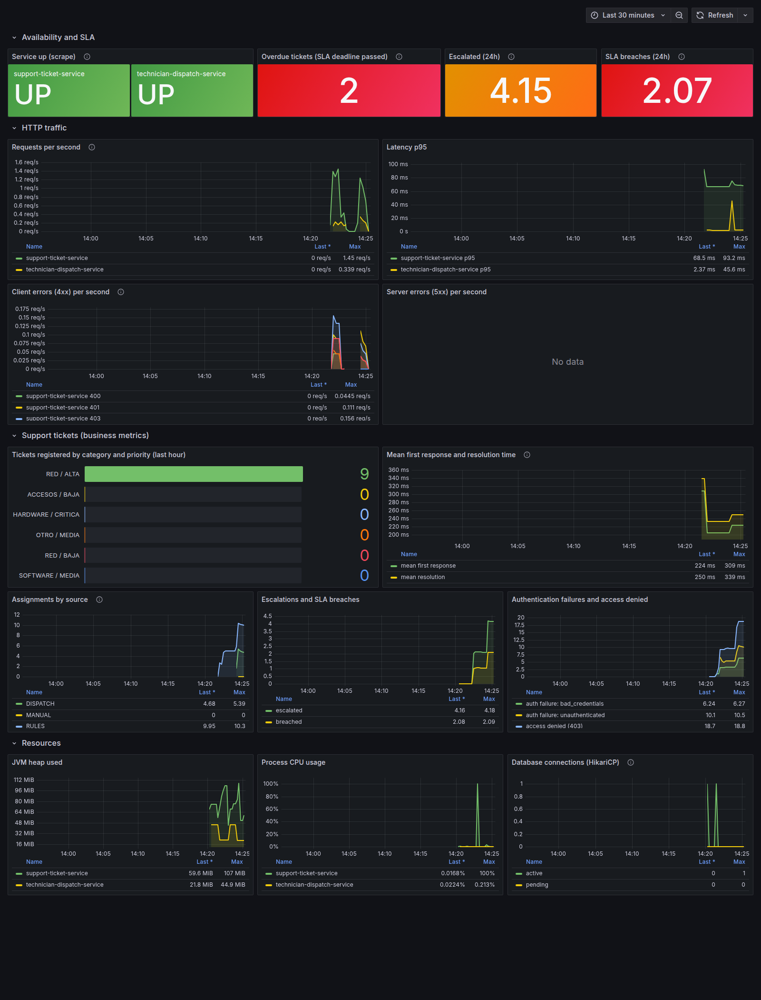

# Evidence of a real run

Everything below was captured from the Docker Compose stack (`docker compose up -d --build`) and from
`./mvnw clean verify`. Identifiers and timestamps are from that run.

## Test results

```
./mvnw clean verify
  technician-dispatch-service   unit tests:        29, failures 0
  support-ticket-service         unit tests:        99, failures 0
  support-ticket-service         integration (Testcontainers PostgreSQL 16): 59, failures 0
./scripts/smoke-test.sh          Result: 31 passed, 0 failed
Postman collection (57 requests) 87 assertions passed, 0 failed
```

## Architecture diagrams

See the README: hexagonal architecture, microservice relation (sequence) and ticket lifecycle (state diagram).

## Metrics

Grafana dashboard *HelpFlow - Services Overview*:



Prometheus endpoint of `support-ticket-service` (`curl localhost:8080/actuator/prometheus | grep ^helpflow_`, tag `application` omitted):

```
helpflow_access_denied_total{} 11.0
helpflow_auth_failures_total{reason="bad_credentials"} 5.0
helpflow_auth_failures_total{reason="unauthenticated"} 7.0
helpflow_tickets_assigned_total{source="DISPATCH"} 4.0
helpflow_tickets_assigned_total{source="MANUAL"} 1.0
helpflow_tickets_assigned_total{source="RULES"} 6.0
helpflow_tickets_escalated_total{} 2.0
helpflow_tickets_first_response_seconds_count{} 1
helpflow_tickets_first_response_seconds_sum{} 0.28053
helpflow_tickets_overdue{} 2.0
helpflow_tickets_registered_total{category="RED",priority="ALTA"} 5.0
helpflow_tickets_registered_total{category="HARDWARE",priority="CRITICA"} 1.0
helpflow_tickets_resolution_seconds_count{} 1
helpflow_tickets_sla_breached_total{} 1.0
```

Prometheus targets (`/api/v1/targets`): `support-ticket-service` up, `technician-dispatch-service` up, `prometheus` up.

## Overdue tickets (SLA)

`./scripts/demo-sla.sh` registers tickets, moves two back in time and runs the SLA review:

```
== Running the SLA review (the scheduler does this every minute)
{"reviewed":6,"escalated":2,"breached":1,"failed":0}
== Overdue tickets
  #5 HARDWARE/CRITICA status=ASIGNADO escalated=true slaBreached=true due=2026-10-27T17:22:25.729812Z
== History of ticket #4
  CREATED    by demo.1793128945@helpflow.example: Ticket registered with SLA deadline 2026-10-28T03:22:25.696267Z
  ASSIGNED   by SYSTEM: Assigned to TEC-013 (DISPATCH, estimated 1h)
  ESCALATED  by SYSTEM: Auto-escalated at 80% of the SLA window (priority ALTA -> CRITICA)
```

`GET /tickets?overdue=true` (admin):

```json
{"id":13,"category":"HARDWARE","priority":"CRITICA","status":"ASIGNADO","escalated":true,
 "slaBreached":true,"slaDueAt":"2026-10-27T17:24:13.477552Z","technician":"TEC-001"}
```

## Structured logs

JSON (ECS) on stdout, one object per line, with the `traceId` that is also returned in `X-Trace-Id` and forwarded to the dispatch service
(pretty-printed here):

```json
{"@timestamp":"2026-10-27T19:24:13.798779154Z","log":{"level":"WARN","logger":"com.helpflow.supportticket.application.service.TicketSlaReviewer"},
 "service":{"name":"support-ticket-service"},"message":"Ticket 13 breached its SLA deadline 2026-10-27T17:24:13.477552Z",
 "traceId":"7126abbe916a496489bef07c55a90004"}
{"@timestamp":"2026-10-27T19:24:13.803135278Z","log":{"level":"INFO"},
 "message":"SLA review: 12 reviewed, 2 escalated, 1 breached, 0 failed","traceId":"7126abbe916a496489bef07c55a90004"}
```

## Dispatch integration

```
POST localhost:8081/technician-dispatch {"ticketId":125,"categoria":"RED","prioridad":"ALTA"}
{"ticketId":125,"tecnicoId":"TEC-008","disponibilidad":"MEDIA","tiempoEstimadoHoras":3}      (same answer on every call)
```

Ticket 1 history: the dispatch suggestion `TEC-006` (a SOFTWARE technician) was not eligible for a RED ticket, so the rules assigned `TEC-007`:

```
ASSIGNED  SYSTEM  Assigned to TEC-007 (RULES). Dispatch suggestion TEC-006 rejected by assignment rules
```

## Error format

```json
{"type":"urn:helpflow:problem:ticket-not-found","title":"Ticket not found","status":404,
 "detail":"Ticket 999 does not exist.","instance":"/tickets/999",
 "timestamp":"2026-10-27T19:25:42.396996542Z","traceId":"da01b6d37b7145d18f0d5ea642e2cc8e"}
```

## Persistence across restarts

After `docker compose down` (without `-v`) and `docker compose up -d`: the ticket count was unchanged (9), Prometheus still
returned its earlier samples and Grafana kept the provisioned dashboard (volumes `helpflow_pgdata`, `helpflow_prometheus-data`, `helpflow_grafana-data`).
