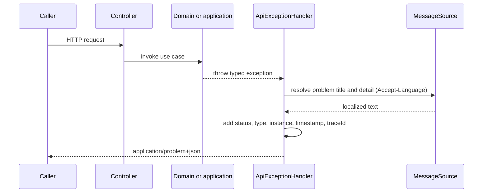

# Error Handling Sequence

The global API advice converts domain, application, framework and unexpected failures to localized `application/problem+json` responses decorated with timestamp, request path and trace ID.

