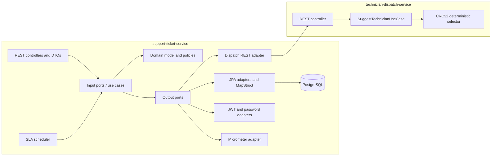

# Hexagonal Architecture by Service

The ticket service owns business rules and persistence; dispatch implements a small stateless selector. Input ports expose use cases, while output ports isolate external dependencies.

