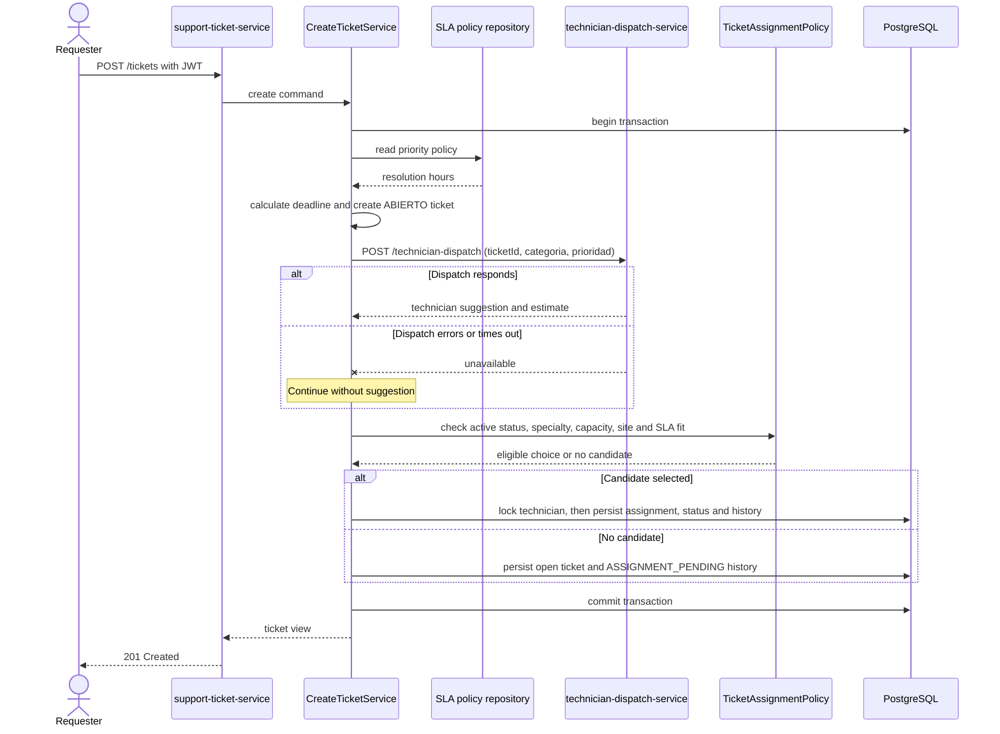

# Ticket Creation and Assignment Sequence

Ticket registration, assignment and audit history share a transaction. Dispatch is synchronous with bounded timeouts; failure allows the internal eligibility and ranking rules to continue.

