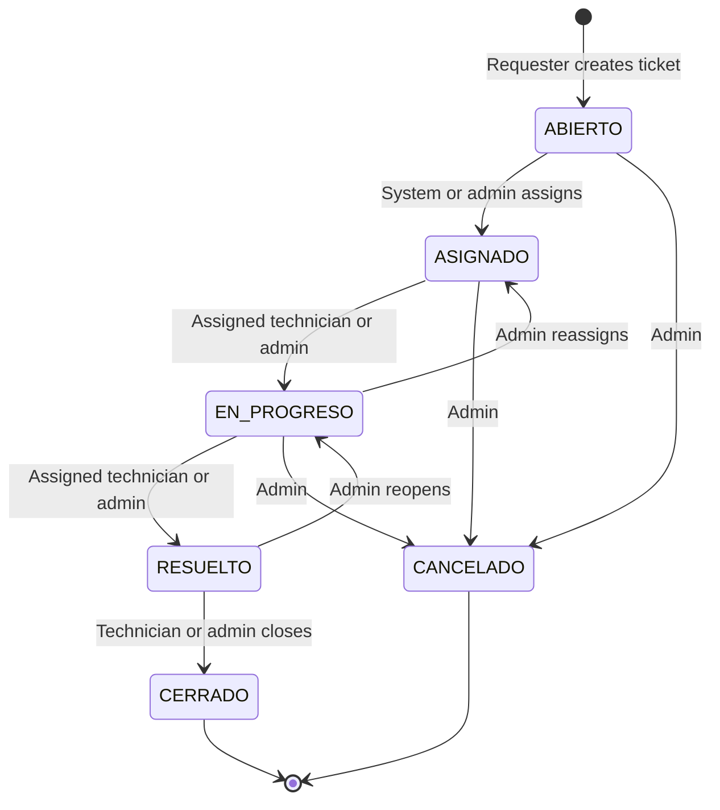

# Ticket Lifecycle

Transitions mirror `TicketStatus` and the web API. Technicians may manage only their assigned tickets; cancellation is administrator-only. Administrative assignment/reassignment moves an open or in-progress ticket to `ASIGNADO`.

