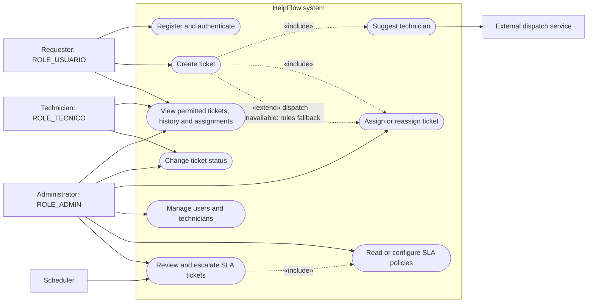

# HelpFlow Use Cases

Actors and system responsibilities shown below follow the implemented API and scheduler. `«include»` labels indicate required subflows; `«extend»` labels indicate conditional behavior.

